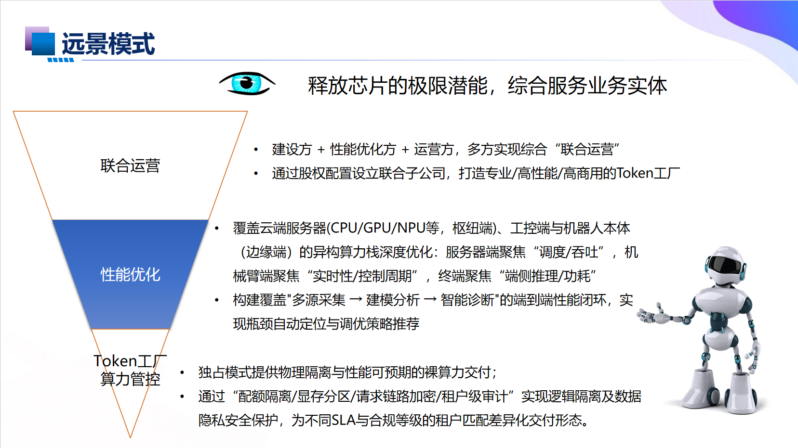
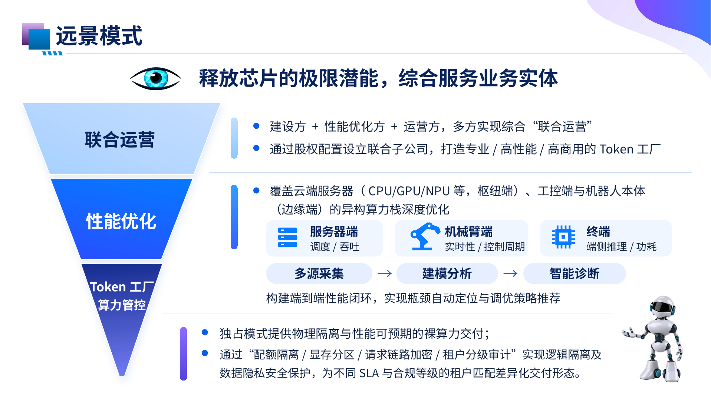

# PPT Beautification Workflow v1.2

**把已有的一页 PPT 美化成真正可编辑的 PowerPoint，而不只是把截图放进 PPT。**

支持输入 **PPTX 文件或单页截图**；优先保留原始文字与数据，复用现有母版风格，先确认视觉效果，再制作可编辑的 `.pptx` 并检查实际渲染结果。

## ✨ 真实案例：远景模式

| 美化前 | 美化后（可编辑 PPTX 的实际渲染） |
| :---: | :---: |
|  |  |

[查看案例详情](examples/vision-mode/README.md) · [下载可编辑 PPTX](examples/vision-mode/vision-mode-editable.pptx)

## 🎯 核心能力

- **单页美化**：调整信息层级、排版、卡片和图形结构，尽量保留原始内容。
- **母版复用**：有 PPTX 时优先沿用其字体、标题、颜色及装饰；只有截图时使用形状重建固定装饰，避免裁切图片造成的重叠。
- **可编辑重建**：文字、卡片、数字、流程与连接线优先使用 PowerPoint 原生对象。
- **图标补全**：底板确定后再单独生成高清图标，统一大小，优先使用透明 PNG 或精确匹配 RGB。
- **结果检查**：最终导出实际预览，检查文字溢出、图标色差、遮挡与布局偏移。

> 当前版本一次专注处理一页。上传多页 PPTX 时，可以指定需要美化的页码。

## 💬 如何使用

### 模式 A：美化重构（推荐）

适合内容已准备好，但希望重新设计视觉效果的场景：

> 使用 `ppt-beautification-workflow` **美化**这一页 PPT。保留原始内容和标题风格，先生成美化效果图；我确认后再制作真正可编辑的 PPTX。请复用或重绘母版装饰，不要简单截图裁切。最后提供实际渲染预览。

### 模式 B：等比例还原

适合已有满意的设计稿，只希望转换为可编辑 PPTX 的场景：

> 使用 `ppt-beautification-workflow` **等比例还原**这张图为可编辑 PPTX，尽量保持原有视觉效果，不做额外美化。文字和图形尽量使用原生可编辑对象，固定角饰请重绘或复用母版。

### 上传原始 PPTX

> 我上传了 PPTX，请只美化其中的第 X 页，优先复用现有母版、标题样式和真实文字。先看效果图，再制作可编辑 PPTX。

**注意：“美化”和“还原”是不同任务。** 只说“变成可编辑 PPT”可能被理解为等比例还原；如果希望重新设计，请明确写“美化”。

## 🔄 工作流

1. 读取原始截图或 PPTX，确认内容与任务模式。
2. 美化模式下先生成单页视觉效果图，等待确认。
3. 使用可编辑文字和图形构建 PPTX，保留或重建原有母版装饰。
4. 根据最终底板补齐独立高清图标。
5. 导出并检查实际预览，修正明显问题后交付。

完整执行规则见 [SKILL.md](SKILL.md)，图标规范见 [icon-spec.md](references/icon-spec.md)，交付检查见 [qa-checklist.md](references/qa-checklist.md)。

## 📥 安装与兼容

本 Skill 采用通用 `SKILL.md` 目录结构，可以在支持 Agent Skills 的 ChatGPT、Codex、Claude Code 等环境中使用。实际的图片生成、PPTX 编辑和渲染能力取决于客户端所提供的工具。

安装示例及仓库说明见 [Agent Skills 首页](../../README.md)。

## 📂 文件结构

```text
ppt-beautification-workflow/
├── SKILL.md
├── README.md
├── references/
│   ├── icon-spec.md
│   └── qa-checklist.md
└── examples/
    └── vision-mode/
        ├── README.md
        ├── before.png
        ├── after.png
        └── vision-mode-editable.pptx
```

**v1.2 的主要改进：** 明确区分“美化重构/等比例还原”，强化原 PPT 母版复用，并避免直接裁切截图中的页眉和边角装饰。